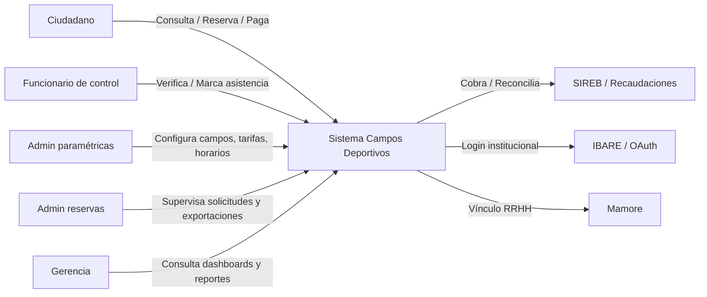
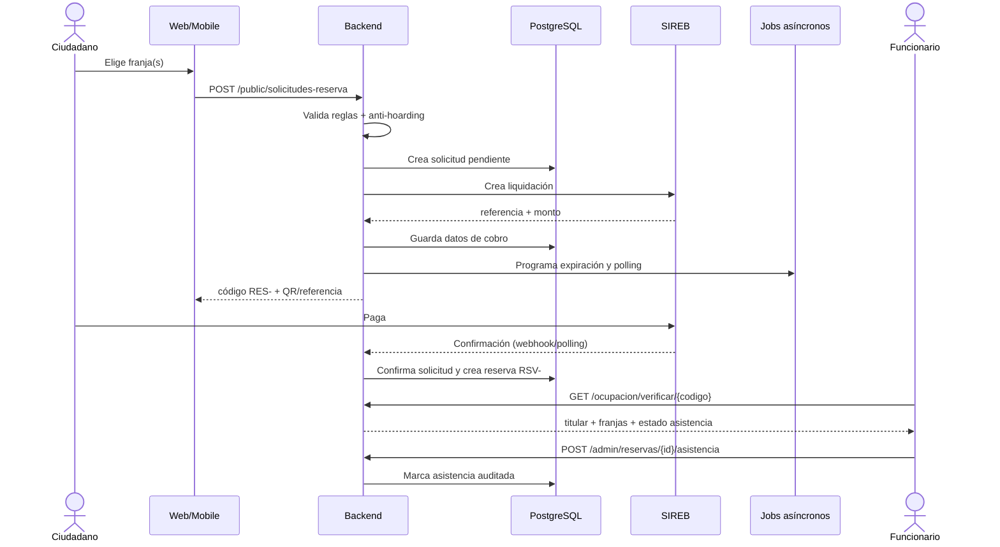
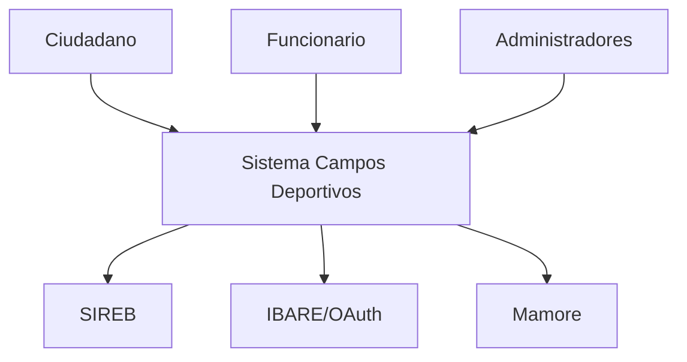
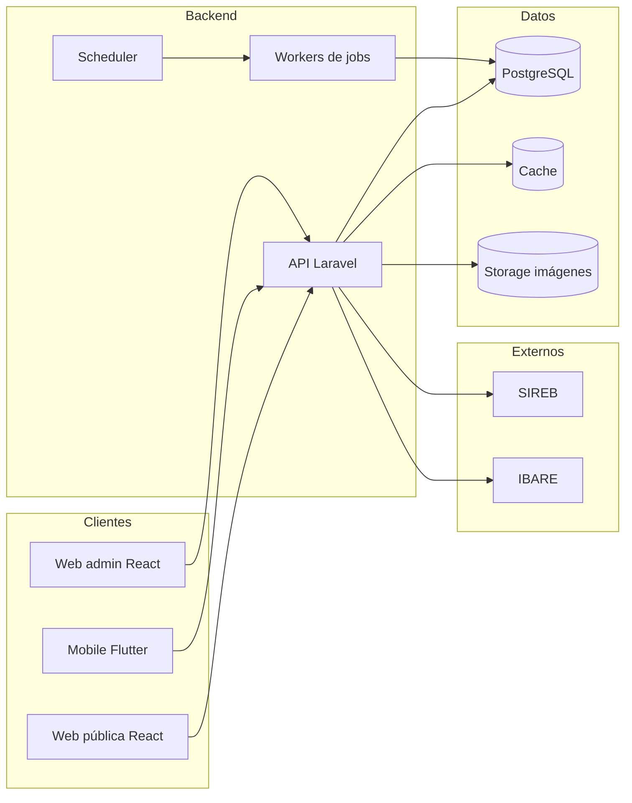
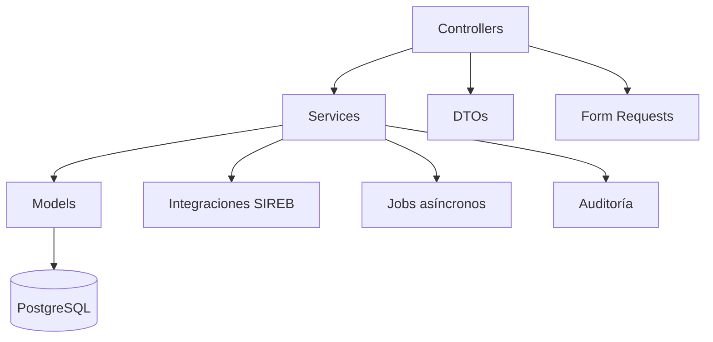
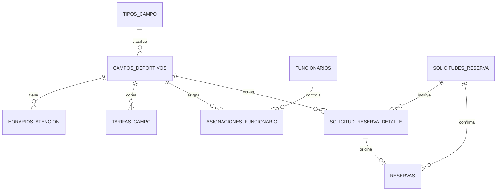

# 🎓 Manual Pedagógico Integral  
## Sistema de Campos Deportivos — GAD Beni

> **Objetivo de este documento:** explicar el sistema completo de la forma más clara posible, sirviendo al mismo tiempo para:
>
> - capacitar ciudadanos,
> - entrenar funcionarios,
> - presentar a autoridades,
> - documentar arquitectura para técnicos,
> - y servir como referencia operativa de largo plazo.

Podés guardarlo como:

```text
docs/MANUAL_PEDAGOGICO_CAMPOS_DEPORTIVOS.md
```

---

# 🧭 Índice general

1. [Cómo usar este manual](#1-cómo-usar-este-manual)
2. [La idea en una frase](#2-la-idea-en-una-frase)
3. [Analogía maestra: el club deportivo digital](#3-analogía-maestra-el-club-deportivo-digital)
4. [Actores del sistema](#4-actores-del-sistema)
5. [Mapa general del flujo](#5-mapa-general-del-flujo)
6. [Paso a paso por usuario](#6-paso-a-paso-por-usuario)
7. [Procesos automáticos invisibles](#7-procesos-automáticos-invisibles)
8. [Reglas de negocio explicadas como semáforo](#8-reglas-de-negocio-explicadas-como-semáforo)
9. [Estados, códigos y diccionario](#9-estados-códigos-y-diccionario)
10. [Arquitectura pedagógica](#10-arquitectura-pedagógica)
11. [Modelo de datos explicado como historia](#11-modelo-de-datos-explicado-como-historia)
12. [Escenarios comunes y errores](#12-escenarios-comunes-y-errores)
13. [Guion para demostración en vivo](#13-guion-para-demostración-en-vivo)
14. [Plan de capacitación por rol](#14-plan-de-capacitación-por-rol)
15. [Quiz pedagógico](#15-quiz-pedagógico)
16. [Versión ejecutiva para autoridades](#16-versión-ejecutiva-para-autoridades)
17. [Versión técnica para desarrollo/operación](#17-versión-técnica-para-desarrollooperación)
18. [Checklist final de puesta en producción](#18-checklist-final-de-puesta-en-producción)

---

# 1. Cómo usar este manual

Este documento está dividido en capas. No necesitás leerlo todo de corrido.

## Si sos **ciudadano**
Leé:

- [La idea en una frase](#2-la-idea-en-una-frase)
- [Analogía maestra](#3-analogía-maestra-el-club-deportivo-digital)
- [Paso a paso: ciudadano](#61-ciudadano--solicitante)
- [Errores comunes](#12-escenarios-comunes-y-errores)

## Si sos **funcionario de control**
Leé:

- [Actores del sistema](#4-actores-del-sistema)
- [Paso a paso: funcionario](#62-funcionario-de-control)
- [Estados y códigos](#9-estados-códigos-y-diccionario)
- [Errores comunes](#12-escenarios-comunes-y-errores)

## Si sos **administrador**
Leé:

- [Paso a paso: admin paramétricas](#63-admin-de-paramétricas)
- [Paso a paso: admin reservas](#64-admin-de-reservas)
- [Procesos automáticos](#7-procesos-automáticos-invisibles)
- [Reglas de negocio](#8-reglas-de-negocio-explicadas-como-semáforo)

## Si sos **gerencia / autoridad**
Leé:

- [La idea en una frase](#2-la-idea-en-una-frase)
- [Mapa general del flujo](#5-mapa-general-del-flujo)
- [Versión ejecutiva](#16-versión-ejecutiva-para-autoridades)

## Si sos **desarrollador / DevOps**
Leé todo, pero especialmente:

- [Arquitectura pedagógica](#10-arquitectura-pedagógica)
- [Modelo de datos](#11-modelo-de-datos-explicado-como-historia)
- [Versión técnica](#17-versión-técnica-para-desarrollooperación)
- [Checklist de producción](#18-checklist-final-de-puesta-en-producción)

---

# 2. La idea en una frase

> **El sistema es una agenda pública inteligente para reservar, cobrar y controlar el uso de campos deportivos municipales.**

Dicho de otra forma:

- el ciudadano **mira** qué canchas están libres,
- **reserva** una franja horaria,
- **paga** por el canal oficial,
- el municipio **confirma** automáticamente,
- el funcionario **controla** en sitio,
- y la administración **supervisa, reporta y audita** todo.

---

# 3. Analogía maestra: el club deportivo digital

Para entender el sistema completo, imaginá un **club deportivo moderno** que funciona así:

| Elemento del club | Equivalente en el sistema |
|---|---|
| Las canchas | `campos_deportivos` |
| Los horarios de juego | `horarios_atencion` |
| Las tarifas de día/noche | `tarifas_campo` |
| El socio que quiere jugar | Ciudadano / solicitante |
| Reservar una hora en la recepción | Crear una solicitud de reserva |
| Apartar la hora provisoriamente | Hold / solicitud pendiente |
| Pagar en caja | Integración con SIREB |
| El ticket con código | `codigo_seguimiento` (`RES-...`) |
| La entrada confirmada | Reserva formal (`RSV-...`) |
| El portero que chequea la entrada | Funcionario de control |
| El gerente que mira ocupación e ingresos | Dashboard / reportes / mapa global |
| La cámara de seguridad que graba movimientos | Auditoría |
| Las reglas internas del club | Reglas de negocio y anti-abuso |

Esta analogía es útil porque permite explicar el sistema sin tecnicismos:

> “Es como un club donde uno reserva la cancha desde el celular, paga oficialmente, y cuando llega muestra su código para que el encargado lo valide y anote que efectivamente entró.”

---

# 4. Actores del sistema

## 4.1 Resumen visual



---

## 4.2 Actor 1: Ciudadano / solicitante

### Quién es
Cualquier persona natural o jurídica que quiere usar una cancha.

### Qué canal usa
- Web pública
- App móvil

### Qué necesita
- No necesita registrarse.
- Solo necesita:
  - nombre o razón social,
  - teléfono,
  - CI/NIT.

### Qué hace
1. Busca campos.
2. Ve disponibilidad.
3. Elige franja(s).
4. Completa datos.
5. Recibe código de pago.
6. Paga.
7. Obtiene comprobante.
8. Presenta el código al ingresar.

### Qué **no** puede hacer
- No accede al panel administrativo.
- No ve datos privados de otros ciudadanos.
- No marca asistencia.
- No configura tarifas ni campos.

---

## 4.3 Actor 2: Funcionario de control

### Quién es
El operador de campo que está en la entrada o en la coordinación del complejo deportivo.

### Qué canal usa
- Panel administrativo web

### Qué hace
1. Inicia sesión.
2. Entra a **Ocupación / Mis campos**.
3. Ve la grilla del día.
4. Verifica un código `RES-` o `RSV-`.
5. Confirma identidad del titular.
6. Marca asistencia.
7. Puede revocar asistencia si corresponde.

### Qué **no** puede hacer
- No ve campos que no estén asignados.
- No puede verificar reservas de campos ajenos.
- No puede modificar paramétricas maestras.
- No puede marcar asistencia fuera de ventana si no es admin.

---

## 4.4 Actor 3: Admin de paramétricas

### Quién es
El responsable de dejar el sistema listo para operar.

### Qué hace
- Alta/baja de tipos de campo.
- Alta/baja de campos deportivos.
- Configuración de horarios de atención.
- Configuración de tarifas diurnas/nocturnas.
- Vinculación con SIREB.
- Gestión de funcionarios.
- Asignación de campos a funcionarios.
- Ajuste de parámetros del sistema.

### Frase clave
> “Este rol construye el tablero de juego.”

---

## 4.5 Actor 4: Admin de reservas

### Quién es
El supervisor operativo del flujo de solicitudes y reservas.

### Qué hace
- Consulta listado de solicitudes.
- Filtra por estado, campo, fecha, pagador.
- Revisa detalle y auditoría.
- Gestiona anulaciones cuando aplica.
- Exporta CSV.

### Frase clave
> “Este rol cuida que el flujo de dinero y reservas sea trazable.”

---

## 4.6 Actor 5: Gerencia / perfil consultivo

### Quién es
Directorio, jefatura o área de control.

### Qué hace
- Ve dashboard general.
- Consulta mapa global de ocupación.
- Revisa reportes de uso.
- Analiza clientes frecuentes.
- Monitorea indicadores.

### Frase clave
> “Este rol no opera día a día: mide y decide.”

---

## 4.7 Sistemas externos

| Sistema | Rol |
|---|---|
| **SIREB / Recaudaciones** | Emite liquidaciones, cobra, confirma pagos, permite anulación cuando aplica |
| **IBARE / OAuth** | Autenticación institucional de funcionarios |
| **Mamore** | Vínculo con identificador de funcionario, si está habilitado |
| **Infraestructura** | Servidores, base de datos, cola, caché, storage, proxy |

---

# 5. Mapa general del flujo

## 5.1 Diagrama maestro

```mermaid
flowchart TD
    A[Ciudadano consulta campos] --> B[Ve disponibilidad por fecha]
    B --> C[Selecciona franja(s) libres]
    C --> D[Completa datos del pagador]
    D --> E[Envía solicitud]
    E --> F{Validaciones backend}
    F -->|Falla| G[Mensaje de error]
    F -->|Pasa| H[Crea solicitud pendiente / hold]
    H --> I[Genera liquidación en SIREB]
    I --> J[Devuelve código RES- y referencia de cobro]
    J --> K[Ciudadano paga]
    K --> L[SIREB confirma pago]
    L --> M[Backend confirma solicitud]
    M --> N[Nace reserva formal RSV-]
    N --> O[Funcionario verifica en sitio]
    O --> P[Marca asistencia]
    P --> Q[Operación, reportes y auditoría]
```

---

## 5.2 Secuencia técnica simplificada



---

# 6. Paso a paso por usuario

---

## 6.1 Ciudadano / solicitante

### Meta
Reservar y pagar una cancha.

---

### Paso 1 — Entrar al canal público
El ciudadano puede usar:

- **web pública**, o
- **app móvil**.

No necesita crear cuenta.

---

### Paso 2 — Explorar campos
Puede ver:

- listado de campos,
- mapa,
- fotos,
- tipo de cancha,
- dirección,
- tarifas,
- horarios de atención.

---

### Paso 3 — Elegir fecha
Puede elegir:

- hoy,
- mañana,
- o una fecha futura dentro de la ventana permitida.

**Regla:**  
La ventana máxima es de **60 días hacia el futuro**.

---

### Paso 4 — Ver la grilla de disponibilidad
El sistema muestra bloques horarios con estados:

| Estado | Significado | Seleccionable |
|---|---|---|
| `libre` | Está disponible | Sí |
| `pendiente` | Alguien la está pagando en este momento | No |
| `ocupada` | Ya fue confirmada | No |
| `pasada` | Ya comenzó o ya pasó | No |

---

### Paso 5 — Seleccionar una o varias franjas
El ciudadano arma un carrito con una o más franjas.

**Regla anti-acaparamiento:**  
Por defecto, máximo **6 franjas por solicitud**.

---

### Paso 6 — Completar datos del pagador
Debe ingresar:

- nombre o razón social,
- teléfono,
- CI/NIT.

Estos datos se usan para:

- emitir la liquidación en SIREB,
- identificar al titular,
- permitir control en sitio.

---

### Paso 7 — Confirmar la solicitud
Al enviar, el backend hace varias cosas en orden:

1. valida formato,
2. valida reglas de negocio,
3. aplica gates anti-hoarding,
4. verifica que las franjas sigan libres,
5. crea una **solicitud pendiente** (hold),
6. intenta crear la liquidación en SIREB.

---

### Paso 8 — Recibir el código de seguimiento
Si todo va bien, el ciudadano recibe:

- `codigo_seguimiento` (`RES-...`),
- referencia de cobro,
- QR/string de pago,
- monto,
- fecha de vencimiento del hold.

---

### Paso 9 — Realizar el pago
El pago se hace por el canal oficial habilitado por SIREB.

---

### Paso 10 — Esperar confirmación
La confirmación puede llegar por:

- webhook,
- polling periódico,
- reconciliación asíncrona.

Cuando el pago se valida:

- la solicitud pasa a `confirmada`,
- nace la reserva formal con código `RSV-...`.

---

### Paso 11 — Consultar estado
El ciudadano puede consultar el estado de su solicitud usando el código `RES-`.

Estados posibles:

- pendiente,
- confirmada,
- expirada,
- cancelada,
- rechazada.

---

### Paso 12 — Obtener comprobante
Si la reserva está confirmada, puede ver/descargar el comprobante.

El comprobante público incluye:

- código,
- campo,
- fecha,
- franja(s),
- monto,
- referencia de cobro,
- información institucional.

**Importante:**  
El comprobante público **no expone datos sensibles innecesarios** del pagador.

---

### Paso 13 — Presentarse en el campo
Al momento de usar la cancha, el ciudadano muestra:

- el código `RES-` del comprobante,
- o el código `RSV-` de la franja,
- y su documento de identidad.

---

## 6.2 Funcionario de control

### Meta
Validar que quien ingresa tenga una reserva legítima y dejar constancia de asistencia.

---

### Paso 1 — Iniciar sesión
Ingresa al panel administrativo con su credencial institucional.

---

### Paso 2 — Ir a Ocupación / Mis campos
Ve únicamente los campos donde está asignado.

---

### Paso 3 — Revisar la grilla del día
Para cada campo visualiza:

- franjas horarias,
- estado: libre / pendiente / ocupada / pasada,
- código `RSV-` de las franjas ocupadas,
- hora de asistencia si ya fue marcada.

El sistema también resalta la franja actual con un marcador temporal.

---

### Paso 4 — Verificar un código
El funcionario puede tipear:

- `RES-...` (código de seguimiento del comprobante),
- `RSV-...` (código de franja).

El sistema responde con:

- titular,
- CI/NIT,
- teléfono,
- campo,
- fecha,
- franja(s),
- estado de asistencia.

---

### Paso 5 — Cruzar identidad
El funcionario compara:

- nombre del titular,
- documento presentado.

---

### Paso 6 — Marcar asistencia
Si corresponde, marca asistencia desde el verificador.

El sistema:

- valida ventana temporal,
- registra quién marcó,
- audita la acción.

**Ventana típica para funcionario de control:**

- desde **1 hora antes** del inicio,
- hasta **24 horas después** del fin.

Fuera de esa ventana, solo un administrador puede marcar.

---

### Paso 7 — Revocar asistencia
Si hubo error, puede revocarla dentro de las reglas permitidas.

---

## 6.3 Admin de paramétricas

### Meta
Dejar el sistema listo para operar.

---

### Paso 1 — Configurar tipos de campo
Ejemplos:

- futsal,
- vóley,
- básquet,
- múltiple.

---

### Paso 2 — Crear/editar campos deportivos
Define:

- nombre,
- código,
- dirección,
- coordenadas,
- estado operativo,
- imagen,
- hora de inicio nocturno.

---

### Paso 3 — Configurar horarios de atención
Por día de la semana:

- hora de apertura,
- hora de cierre.

Si un día no tiene horario, el campo aparece como **cerrado** para esa fecha.

---

### Paso 4 — Definir tarifas
Carga tarifas vigentes:

- diurna,
- nocturna.

El sistema calcula el tipo según:

- hora de inicio de la franja,
- parámetro `hora_inicio_noche` del campo.

---

### Paso 5 — Vincular con SIREB
Asocia el campo al servicio/tarifa SIREB correspondiente.

Esto es crítico para:

- crear liquidaciones válidas,
- cobrar correctamente,
- mantener trazabilidad tributaria.

---

### Paso 6 — Gestionar funcionarios
Crea/edita funcionarios y define:

- rol,
- estado,
- identificador externo si aplica.

---

### Paso 7 — Asignar campos a funcionarios
Determina qué funcionario controla qué campo.

Esto alimenta:

- `mis-campos`,
- restricciones de verificación,
- permisos de asistencia.

---

### Paso 8 — Ajustar parámetros del sistema
Puede modificar, sin redeploy, valores como:

- minutos de expiración del hold,
- intervalo de polling,
- máximo de franjas por solicitud,
- máximo de pendientes por IP,
- umbral de expiraciones para cooldown,
- duración del cooldown.

---

## 6.4 Admin de reservas

### Meta
Supervisar el flujo de solicitudes y resolver incidencias.

---

### Paso 1 — Entrar al módulo de reservas
Ve listado de solicitudes con filtros:

- estado,
- fecha,
- campo,
- pagador,
- teléfono,
- CI/NIT.

---

### Paso 2 — Revisar detalle de una solicitud
Visualiza:

- datos del pagador,
- franjas,
- estado,
- referencias SIREB,
- reservas generadas,
- auditoría.

---

### Paso 3 — Gestionar anulaciones
Cuando el procedimiento lo permite, puede anular liquidaciones o solicitudes asociadas.

---

### Paso 4 — Exportar CSV
Genera exportados operativos para:

- conciliación,
- reporte interno,
- estadística,
- control de campo.

---

## 6.5 Gerencia

### Meta
Monitoreo estratégico.

---

### Paso 1 — Dashboard general
Ve indicadores como:

- solicitudes por estado,
- ocupación,
- montos confirmados,
- comportamiento por periodo.

---

### Paso 2 — Mapa global
Visualiza todos los campos con:

- ubicación,
- ocupación del día,
- porcentaje de uso,
- estado operativo,
- vínculo SIREB.

---

### Paso 3 — Reportes
Analiza:

- clientes frecuentes,
- uso por campo,
- tendencias horarias,
- desempeño operativo.

---

# 7. Procesos automáticos invisibles

Estos son los que el usuario no ve directamente, pero sostienen la operación.

---

## 7.1 Hold / expiración de solicitud
Cuando se crea una solicitud pendiente:

- se bloquean temporalmente las franjas,
- se programa expiración automática.

Si no se confirma el pago a tiempo:

- la solicitud pasa a `expirada`,
- las franjas se liberan.

---

## 7.2 Reintento de cobro
Si la creación de liquidación en SIREB falla por timeout o error transitorio:

- se despacha un job de reintento,
- se intentan varios reintentos,
- si falla definitivamente, la solicitud puede rechazarse con motivo operativo.

---

## 7.3 Polling de confirmación
El sistema consulta periódicamente el estado del cobro para:

- detectar pagos confirmados,
- reconciliar solicitudes pendientes.

---

## 7.4 Webhook de recaudaciones
Si SIREB notifica activamente:

- el sistema recibe el evento,
- valida payload,
- confirma la solicitud,
- genera reservas formales.

---

## 7.5 Concurrencia y no solape
Para evitar doble reserva:

- validación aplicativa previa,
- restricción de exclusión en base de datos,
- transacción atómica.

Si dos ciudadanos intentan la misma franja:

- uno gana,
- el otro recibe error de franja no disponible.

---

## 7.6 Anti-hoarding (acaparamiento)
Tres capas:

### M1 — Máximo de franjas por solicitud
Limita cuántas franjas puede pedir un ciudadano en una sola solicitud.

### M2 — Máximo de pendientes activas por IP
Evita que una misma IP acumule muchas solicitudes sin pagar.

### M3 — Cooldown por expiraciones repetidas
Si una IP expira muchas solicitudes en poco tiempo, se bloquea temporalmente.

Todo esto es configurable desde parámetros del sistema.

---

## 7.7 Auditoría
Cada acción sensible queda trazada:

- creación de solicitud,
- liquidación creada,
- confirmación de pago,
- expiración,
- anulación,
- marca/revocación de asistencia,
- cambios de paramétricas.

---

## 7.8 Zona horaria Bolivia
Toda la lógica temporal relevante usa:

```text
America/La_Paz
```

Esto evita errores como:

- reservar una franja que ya pasó,
- calcular mal “hoy”,
- romper ventanas nocturnas por server UTC.

---

# 8. Reglas de negocio explicadas como semáforo

## 🟢 Verde: se permite
- Reservar una franja `libre`.
- Reservar hasta 60 días hacia el futuro.
- Seleccionar hasta 6 franjas por solicitud (por defecto).
- Marcar asistencia dentro de ventana.
- Ver ocupación propia si el funcionario está asignado.

## 🟡 Amarillo: condicionado
- Una franja `pendiente` no se puede tomar porque está en hold.
- Una IP con muchas pendientes no puede crear otra hasta pagar/expirar.
- Un funcionario no asignado no puede verificar ciertas reservas.
- Un estado desconocido en la grilla se trata como no seleccionable.

## 🔴 Rojo: se bloquea
- Reservar una franja `pasada`.
- Reservar una franja ya `ocupada`.
- Superponer franjas en la misma solicitud.
- Saltarse validaciones de SIREB.
- Acceder a campos ajenos sin permiso.
- Marcar asistencia fuera de ventana sin ser admin.

---

# 9. Estados, códigos y diccionario

## 9.1 Códigos

| Código | Prefijo | Qué representa |
|---|---|---|
| `codigo_seguimiento` | `RES-...` | La solicitud completa del ciudadano |
| `codigo_reserva` | `RSV-...` | Una franja confirmada individual |

### Analogía
- `RES-` = “tu pedido completo”
- `RSV-` = “cada entrada confirmada de tu pedido”

---

## 9.2 Estados de solicitud

| Estado | Significado |
|---|---|
| `pendiente` | Creada, esperando pago |
| `confirmada` | Pago validado, reservas nacieron |
| `expirada` | No se pagó a tiempo |
| `cancelada` | Anulada operativamente |
| `rechazada` | Falló el proceso de cobro o regla de negocio |

---

## 9.3 Estados de franja en grilla

| Estado | Significado |
|---|---|
| `libre` | Disponible |
| `pendiente` | En hold de cobro |
| `ocupada` | Confirmada |
| `pasada` | Ya comenzó o ya pasó |

---

## 9.4 Estados de campo

| Estado | Significado |
|---|---|
| `activo` | Operable normalmente |
| `mantenimiento` | Visible en operación, pero no reservable |
| `inactivo` | Fuera de servicio |

---

# 10. Arquitectura pedagógica

## 10.1 Nivel 1: contexto



---

## 10.2 Nivel 2: contenedores



---

## 10.3 Nivel 3: componentes del backend



### Responsabilidades
- **Controllers:** reciben HTTP, validan entrada, devuelven respuesta.
- **Services:** reglas de negocio, orquestación, transacciones.
- **Models:** entidades y relaciones.
- **DTOs:** transporte tipado de datos.
- **Jobs:** procesos asíncronos (expiración, polling, reintento).
- **Integrations:** cliente SIREB real/simulado.

---

# 11. Modelo de datos explicado como historia

## 11.1 Entidades principales

| Tabla | Qué guarda | Analogía |
|---|---|---|
| `tipos_campo` | Clasificación de canchas | “Deporte” |
| `campos_deportivos` | Cada cancha física | “La sala” |
| `horarios_atencion` | Cuándo abre/cierra | “El cartel de horarios” |
| `tarifas_campo` | Cuánto cuesta por hora | “La lista de precios” |
| `funcionarios` | Usuarios internos | “El personal” |
| `asignaciones_funcionario` | Quién cuida qué cancha | “El reparto de llaves” |
| `solicitudes_reserva` | Pedido del ciudadano | “La comanda” |
| `solicitud_reserva_detalle` | Franjas del pedido | “Los platos de la comanda” |
| `reservas` | Franja confirmada | “El ticket ya pagado” |
| `parametros_sistema` | Configuración dinámica | “Las perillas del tablero” |
| `auditoria` | Historial de acciones | “La cámara de seguridad” |

---

## 11.2 Relaciones clave



---

# 12. Escenarios comunes y errores

## 12.1 “La franja ya no está disponible”
**Qué significa:** otra persona ganó la carrera por esa franja.  
**Qué hacer:** elegir otra franja o volver a intentar en unos minutos.

---

## 12.2 “La franja ya comenzó”
**Qué significa:** estás tratando de reservar una hora que ya pasó.  
**Qué hacer:** elegir una franja futura.

---

## 12.3 “Tenés reservas pendientes por pagar”
**Qué significa:** el gate anti-hoarding M2 bloqueó una nueva solicitud.  
**Qué hacer:** pagar la pendiente o esperar a que expire.

---

## 12.4 “Esta IP fue bloqueada temporalmente”
**Qué significa:** se activó el cooldown M3 por muchas expiraciones.  
**Qué hacer:** esperar el tiempo indicado o usar otra red legítima.

---

## 12.5 “Código de reserva no encontrado”
**Qué significa:** el código no existe, no está confirmado, o el funcionario no tiene acceso al campo.  
**Qué hacer:** verificar que el ciudadano tenga comprobante confirmado y que el funcionario esté asignado.

---

## 12.6 “Fuera de ventana temporal”
**Qué significa:** el funcionario intentó marcar asistencia demasiado temprano o demasiado tarde.  
**Qué hacer:** usar admin si corresponde excepción.

---

## 12.7 “El campo no tiene tarifa vigente definida”
**Qué significa:** falta configurar tarifas.  
**Qué hacer:** admin paramétricas debe cargar tarifa diurna/nocturna vigente.

---

## 12.8 “Campo no tiene servicio SIREB mapeado”
**Qué significa:** falta vinculación con catálogo SIREB.  
**Qué hacer:** ejecutar mapeo o configurar vínculo desde admin.

---

# 13. Guion para demostración en vivo

## Duración sugerida: 10 minutos

### Minuto 0–1: contexto
> “Este sistema permite reservar canchas municipales desde web o celular, pagar oficialmente por SIREB, y controlar en sitio con funcionario.”

### Minuto 1–3: ciudadano
Mostrar:
- listado de campos,
- mapa,
- grilla de disponibilidad,
- selección de franja,
- formulario,
- código `RES-`.

### Minuto 3–5: cobro
Mostrar:
- referencia SIREB,
- QR/string,
- estado pendiente,
- confirmación simulada o real.

### Minuto 5–7: funcionario
Mostrar:
- login,
- mis campos,
- verificador,
- titular,
- marcar asistencia.

### Minuto 7–9: administración
Mostrar:
- paramétricas,
- tarifas,
- horarios,
- asignaciones,
- mapa global,
- reportes.

### Minuto 9–10: cierre
> “El sistema cierra el ciclo completo: consulta, reserva, cobro, confirmación, control, auditoría y reporting.”

---

# 14. Plan de capacitación por rol

## 14.1 Ciudadano
**Duración:** 10 minutos  
**Objetivo:** que pueda reservar solo.

### Contenido
- buscar campo,
- ver disponibilidad,
- seleccionar franja,
- completar datos,
- pagar,
- guardar comprobante.

### Evaluación
- ¿Sabe distinguir `libre`, `pendiente`, `ocupada`, `pasada`?
- ¿Sabe qué código mostrar en sitio?

---

## 14.2 Funcionario de control
**Duración:** 20 minutos  
**Objetivo:** que pueda verificar y marcar asistencia.

### Contenido
- login,
- mis campos,
- verificador,
- cruce de identidad,
- marcar/revocar asistencia.

### Evaluación
- ¿Entiende la diferencia entre `RES-` y `RSV-`?
- ¿Sabe qué hacer si el sistema dice “no tenés acceso”?

---

## 14.3 Admin paramétricas
**Duración:** 45 minutos  
**Objetivo:** que pueda dejar el sistema operativo.

### Contenido
- tipos,
- campos,
- horarios,
- tarifas,
- SIREB,
- funcionarios,
- asignaciones,
- parámetros.

### Evaluación
- ¿Sabe por qué un campo no aparece reservable?
- ¿Sabe qué configurar si cambia la tarifa nocturna?

---

## 14.4 Admin reservas
**Duración:** 30 minutos  
**Objetivo:** que pueda supervisar e incidir.

### Contenido
- filtros,
- detalle,
- auditoría,
- anulación,
- exportación.

### Evaluación
- ¿Sabe rastrear una solicitud desde `RES-` hasta `RSV-`?

---

## 14.5 Gerencia
**Duración:** 15 minutos  
**Objetivo:** que interprete indicadores.

### Contenido
- dashboard,
- mapa global,
- reportes,
- clientes frecuentes.

### Evaluación
- ¿Sabe leer ocupación y recaudación confirmada?

---

# 15. Quiz pedagógico

## Preguntas

1. ¿Qué representa el código `RES-`?
2. ¿Qué representa el código `RSV-`?
3. ¿Un ciudadano necesita registrarse?
4. ¿Qué estados puede tener una franja en la grilla?
5. ¿Por qué una franja puede aparecer como `pasada`?
6. ¿Qué hace el funcionario de control en sitio?
7. ¿Qué rol configura tarifas y horarios?
8. ¿Qué sistema externo interviene en el cobro?
9. ¿Qué pasa si dos personas intentan reservar la misma franja?
10. ¿Qué protege el anti-hoarding?

## Respuestas

1. La solicitud completa del ciudadano.
2. Una franja confirmada individual.
3. No.
4. `libre`, `pendiente`, `ocupada`, `pasada`.
5. Porque ya comenzó según hora Bolivia.
6. Verifica código, cruza identidad y marca asistencia.
7. Admin de paramétricas.
8. SIREB / Recaudaciones.
9. Uno gana y el otro recibe error de franja no disponible.
10. Evita acaparamiento de franjas mediante límites por solicitud, IP y expiraciones.

---

# 16. Versión ejecutiva para autoridades

## Elevator pitch de 30 segundos
> “Este sistema digitaliza la reserva y cobro de campos deportivos municipales. Permite que el ciudadano reserve desde web o celular, pague por el canal oficial de recaudación, y que el municipio controle en sitio quién usa cada cancha. Además entrega trazabilidad financiera, auditoría y reportes de ocupación para toma de decisiones.”

## Beneficios clave
- **Transparencia:** reglas claras y trazables.
- **Formalización del cobro:** integración con SIREB.
- **Control operativo:** verificación en sitio y asistencia.
- **Reducción de discrecionalidad:** permisos, asignaciones y auditoría.
- **Mejor información:** dashboards, mapa global y reportes.
- **Prevención de abuso:** anti-doble reserva y anti-hoarding.

## Indicadores sugeridos
- solicitudes creadas,
- solicitudes confirmadas,
- tasa de expiración,
- ocupación por campo,
- franjas vendidas por hora,
- recaudación confirmada,
- asistencia marcada vs reservas confirmadas.

---

# 17. Versión técnica para desarrollo/operación

## 17.1 Endpoints principales

### Públicos
- `GET /api/v1/public/campos`
- `GET /api/v1/public/campos/{id}/disponibilidad`
- `POST /api/v1/public/solicitudes-reserva`
- consulta de estado por código `RES-`

### Ocupación / control
- `GET /api/v1/ocupacion/mis-campos`
- `GET /api/v1/ocupacion/verificar/{codigo}`
- `GET /api/v1/ocupacion/mapa-global`

### Asistencia
- `POST /api/v1/admin/reservas/{id}/asistencia`

---

## 17.2 Servicios críticos
- `SolicitudReservaService`
- `DisponibilidadService`
- `OcupacionService`
- `MarcarAsistenciaService`
- `CatalogoSirebService`
- `ConfirmacionCobroService`
- `AuditoriaService`

---

## 17.3 Jobs críticos
- `ExpirarSolicitudJob`
- `PollingSolicitudJob`
- `ReintentarSolicitudJob`

---

## 17.4 Parámetros configurables
- `solicitud_reserva_expiracion_minutos`
- `polling_intervalo_segundos`
- `max_franjas_por_solicitud`
- `max_pendientes_por_ip`
- `umbral_expiraciones_cooldown`
- `cooldown_expiracion_minutos`

---

## 17.5 Tests relevantes
- `OcupacionTest`
- `AntiHoardingTest`
- `SolicitudReservaControllerTest`
- `DisponibilidadControllerTest`
- `AsistenciaReservaTest`
- `SolicitudesJobsTest`

---

## 17.6 Comandos útiles

### Backend
```bash
php artisan test --filter=OcupacionTest
php artisan test --filter=AntiHoardingTest
php artisan migrate --force
php artisan db:seed --class=ParametrosSistemaSeeder --force
php artisan config:clear
php artisan cache:clear
php artisan route:clear
php artisan optimize
```

### Front
```bash
npm run build
```

### Mobile
```bash
flutter analyze
```

---

# 18. Checklist final de puesta en producción

## 18.1 Configuración
- [ ] Variables de entorno cargadas
- [ ] Conexión PostgreSQL OK
- [ ] Cache configurada
- [ ] Cola de trabajos configurada
- [ ] Scheduler activo
- [ ] Storage para imágenes operativo
- [ ] TrustProxies configurado para IP real detrás de proxy

## 18.2 Integraciones
- [ ] Credenciales SIREB configuradas
- [ ] Webhook SIREB apuntando correctamente
- [ ] Cliente IBARE/OAuth operativo
- [ ] Mamore vinculado si aplica

## 18.3 Datos maestros
- [ ] Roles sembrados
- [ ] Funcionarios creados
- [ ] Asignaciones campo-funcionario listas
- [ ] Tipos de campo cargados
- [ ] Campos creados
- [ ] Horarios de atención configurados
- [ ] Tarifas vigentes cargadas
- [ ] Vínculo SIREB por campo resuelto

## 18.4 Seguridad y cumplimiento
- [ ] Auditoría activa
- [ ] Privacidad de PII respetada en endpoints públicos
- [ ] Restricciones server-side por rol/asignación verificadas
- [ ] Gates anti-hoarding activos
- [ ] Backup de BD configurado

## 18.5 Verificación final
- [ ] Tests backend verdes
- [ ] Build web público OK
- [ ] Build web admin OK
- [ ] `flutter analyze` limpio
- [ ] Smoke manual de reserva → pago → confirmación → asistencia OK

---

# 🧠 Cierre pedagógico

Si tuvieras que explicar el sistema en **una sola imagen mental**, sería esta:

> **El ciudadano pide, el sistema aparta, SIREB cobra, el municipio confirma, el funcionario controla y la administración mide.**

O en una frase aún más simple:

> **Es la agenda oficial de las canchas del municipio: reserva online, cobro formal y control en sitio.**

---

Si querés, en el próximo paso te puedo convertir esto en **uno de estos tres entregables finales**:

1. **Manual de usuario imprimible por rol**
2. **Presentación ejecutiva slide-by-slide**
3. **Documento técnico de arquitectura para repositorio**

Y si querés, también te lo puedo dejar en formato **aún más didáctico**, con:
- diagramas BPMN textuales,
- casos de uso UML,
- guiones de capacitación por sesión,
- o un “mapa de pantallas” rol por rol.


1. **Smoke manual de hoarding en local/staging**: crear 3 pendientes sin pagar y verificar que la 4ª devuelve 422 de M2; luego esperar expiración y verificar cooldown M3.
2. **Marcar asistencia desde la grilla del admin**, no solo desde el verificador.
3. **Higiene de repo/gitignore**: sacar cache de tests, views compiladas, `mobile/build`, `.dart_tool`, etc.
4. **NIT del emisor en comprobante PDF**, si ya tenés el dato institucional.
