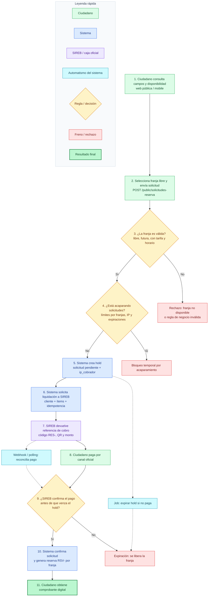

1. **“El ciudadano entra sin registrarse, consulta disponibilidad real y selecciona una franja libre.”**  
   Eso cubre los pasos 1 y 2.

2. **“El sistema valida antes de apartar: que la cancha esté libre, que la hora no haya pasado, que exista tarifa vigente y que no se esté acaparando horarios.”**  
   Eso son los rombos 3 y 4, más los frenos rojos.

3. **“Si pasa las validaciones, el sistema crea un hold: una reserva provisional con vencimiento, asociada a la IP del solicitante para control anti-abuso.”**  
   Paso 5. Acá ya suena técnico pero comprensible.

4. **“Luego el sistema pide la liquidación a SIREB, que es la caja oficial. SIREB devuelve el código de seguimiento `RES-`, el QR y el monto.”**  
   Pasos 6 y 7. Importante: el cobro no lo inventa el sistema, lo gestiona SIREB.

5. **“El ciudadano paga por el canal oficial. El pago no lo confirma el ciudadano ni el sistema por sí solo: lo confirma SIREB mediante webhook o polling.”**  
   Pasos 8, 9 y automatismo A2. Esta frase es clave para transparencia.

6. **“Cuando SIREB confirma, el sistema convierte la solicitud en reserva confirmada y genera el código definitivo `RSV-` por franja. Ahí nace el comprobante.”**  
   Pasos 10 y 11.

7. **“Si no paga a tiempo, el hold expira y la franja vuelve a quedar libre. Eso evita que alguien bloquee horarios sin concretar el pago.”**  
   Automatismo A1 y freno F3.

> “Este flujo asegura tres cosas: disponibilidad real para el ciudadano, cobro oficial trazado por SIREB y control automático contra acaparamiento o reservas fantasma.”

