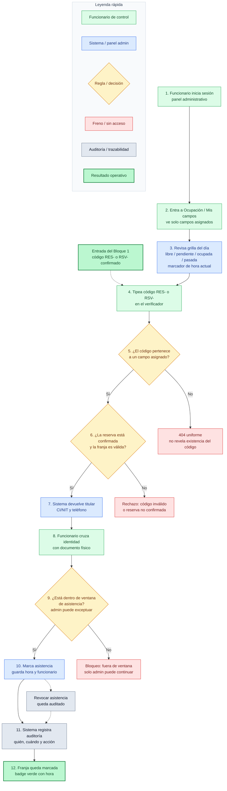

> “El Bloque 1 termina cuando el ciudadano ya pagó y tiene un código `RES-` o `RSV-`.  
> Ese código entra al Bloque 2, donde el funcionario de control lo verifica en sitio.”

Después señalás el diagrama:

### 1. Acceso limitado por asignación

> “El funcionario inicia sesión y entra a Ocupación / Mis campos.  
> Acá el sistema ya aplica una regla importante: **solo ve los campos donde está asignado**.  
> No puede mirar reservas de otros complejos deportivos ni de campos que no controla.”

Eso son los pasos **1, 2 y 3**.

---

### 2. Verificación del código

> “Cuando llega un ciudadano, el funcionario tipea el código `RES-` o `RSV-`.  
> El sistema acepta ambos formatos porque el `RES-` representa la solicitud completa y el `RSV-` representa una franja confirmada.”

Ese es el paso **4**.

---

### 3. Seguridad server-side

> “Si el código no pertenece a un campo asignado, el sistema responde un **404 uniforme**.  
> Es decir: no le dice al funcionario ‘ese código existe pero no es tuyo’.  
> Simplemente no lo encuentra. Eso evita filtrar información.”

Ese es eldecision **5** y el freno **R1**.

---

### 4. Confirmación de reserva válida

> “Si el código sí corresponde a un campo asignado, el sistema valida que la reserva esté confirmada y que la franja sea válida.  
> Si no está confirmada, no se puede marcar asistencia.”

Esa es la decisión **6** y el freno **R2**.

---

### 5. Cruce de identidad

> “Cuando la reserva es válida, el sistema muestra el titular, CI/NIT y teléfono.  
> El funcionario cruza esos datos con el documento físico de la persona.”

Esos son los pasos **7 y 8**.

---

### 6. Ventana de asistencia

> “Antes de marcar asistencia, el sistema valida que esté dentro de la ventana permitida.  
> Para funcionario de control, normalmente es desde una hora antes del inicio hasta veinticuatro horas después del fin.  
> Fuera de esa ventana, solo un administrador puede continuar.”

Esa es la decisión **9** y el freno **R3**.

---

### 7. Marca de asistencia y auditoría

> “Si todo está correcto, el funcionario marca asistencia.  
> El sistema guarda la hora, el funcionario y la acción.  
> Además queda registrado en auditoría: quién marcó, cuándo y sobre qué reserva.”

Esos son los pasos **10, 11 y 12**.

---

### 8. Revocación controlada

> “Si hubo un error, se puede revocar la asistencia, pero también queda auditada.  
> No es un borrón y cuenta nueva: hay trazabilidad.”

Eso es **R4** conectado de vuelta a auditoría.

---

## Frase de cierre para el jefe

> “Este bloque cierra el control operativo: el ciudadano ya pagó, el sistema ya confirmó la reserva, y ahora el funcionario valida en sitio quién entra, cruza identidad y marca asistencia con trazabilidad completa.”

---

## Cadena completa entre Bloque 1 y Bloque 2

Si querés mostrarle la conexión directa:

```text
Bloque 1: Ciudadano reserva y paga
          ↓
       código RES- / RSV-
          ↓
Bloque 2: Funcionario verifica en sitio y marca asistencia
```

O en una frase:

> “El Bloque 1 genera la reserva válida.  
> El Bloque 2 controla que esa reserva se use correctamente en sitio.”



---


