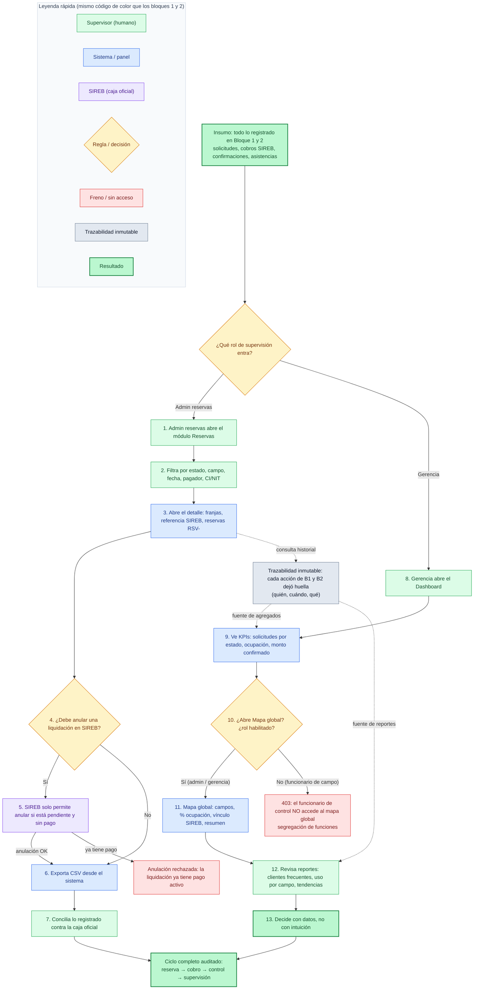

Mismo registro que los dos anteriores: **institucional, técnico-medio, sin “vecino”**, y con la paleta de colores **consistente con la serie** (verde = actor humano, azul = sistema, morado = SIREB, ámbar = decisión, rojo = freno, gris = trazabilidad, verde fuerte = resultado). Así, cuando el jefe tenga las tres láminas juntas, el color significa lo mismo en las tres.

La particularidad del Bloque 3 es que hay **dos supervisores que miran la misma información desde capas distintas**: el **Admin de reservas** cuadra la plata y persigue una solicitud; la **Gerencia** mide el conjunto y decide. El diagrama los muestra como dos ramas paralelas que convergen en un mismo sustrato: la **trazabilidad inmutable** que dejaron los bloques 1 y 2.

Copiá esto en un `.md` o en [mermaid.live](https://mermaid.live) para exportarlo a PNG/SVG.



---

## Cómo explicarlo al jefe en 1 minuto

### 0. El insumo (nodo gris-verde de arriba)
> “Antes de que la administración haga nada, ya tiene todo servido: cada solicitud, cada cobro de SIREB, cada confirmación y cada asistencia marcada en sitio **ya está registrada acá**. Este bloque no genera datos, **los consume**.”

### 1. El sistema identifica el rol (rombo de entrada)
> “Lo primero que hace el panel es saber **quién entró**. No es lo mismo administrar reservas que dirigir. Cada rol ve una capa distinta del mismo dato, y eso es control interno: **nadie ve lo que no le toca**.”

### 2. Rama Admin de reservas (pasos 1–7, verde + azul + morado)
> “El admin de reservas **persigue una solicitud concreta**: filtra por estado, campo, fecha o pagador, abre el detalle y ve las franjas, la referencia de SIREB y las reservas `RSV-` que nacieron.”
> “Si hace falta anular una liquidación, el sistema **no deja anular cualquier cosa**: SIREB solo permite anular si está pendiente y sin pago. Si ya hay plata, frena (rojo). Eso evita que alguien deshaga un cobro ya hecho.”
> “Y cierra con lo que más le importa a vos: **exporta a CSV y concilia contra la caja oficial**. Es decir, cuadramos lo que el sistema dice que cobró contra lo que SIREB dice que entró. **La plata no se declara, se comprueba.**”

### 3. Rama Gerencia (pasos 8–13, verde + azul)
> “La gerencia no persigue una solicitud: **mide el conjunto**. Ve KPIs —solicitudes por estado, ocupación, monto confirmado—, abre el **mapa global** con todos los campos, su porcentaje de uso y su vínculo con SIREB, y revisa reportes de clientes frecuentes y tendencias horarias.”
> “Acá hay un detalle de seguridad que vale la pena remarcar: el mapa global **es de nivel supervisión**. Si un funcionario de campo intentara abrirlo, el sistema lo frena con un 403 (rojo). **El que está en la puerta no ve el tablero global: separación de funciones.**”
> “Y el resultado no es un número lindo: es **decidir con datos**. Cuántas canchas, a qué hora, con qué ocupación, cuánta plata confirmada.”

### 4. La trazabilidad transversal (nodo gris, líneas punteadas)
> “Fijate en las líneas punteadas grises: son la columna vertebral de los tres bloques. **Cada acción dejó huella inmutable** —quién, cuándo, qué—. De ese mismo sustrato sale tanto el historial de una sola solicitud (ramo admin) como los indicadores globales (ramo gerencia). No hay dos versiones de la verdad: **una sola auditoría alimentando todo**.”

### 5. El cierre (nodo verde fuerte de abajo)
> “Y así se cierra la cadena: **reserva → cobro → control → supervisión**, un solo hilo, auditado de punta a punta.”

---

## Frase de cierre para el jefe

> “Este bloque es el que convierte la operación en **evidencia**: el admin cuadra la plata contra SIREB y persigue cualquier solicitud; la gerencia mide uso y recaudación confirmada y decide con datos; y ambos se apoyan en la misma trazabilidad inmutable que dejaron el ciudadano y el funcionario. **Nada se pierde, nada se inventa, todo es reconstruible.**”

---

## Cadena completa de las tres láminas

Si proyectás las tres juntas, el relato queda así:

```text
BLOQUE 1  🧍 Ciudadano reserva y paga        →  nace RES- / RSV-
BLOQUE 2  🪪 Funcionario controla en sitio   →  verifica identidad y marca asistencia
BLOQUE 3  📋 Administración supervisa      →  concilia la plata y mide el conjunto
                    ↓
        un solo sustrato de trazabilidad inmutable
                    ↓
        reserva → cobro oficial → control → supervisión, auditado
```

O en una frase para el cierre de la reunión:

> “El ciudadano pide y paga por la caja oficial, el funcionario valida en la puerta quién entra, y la administración comprueba la plata y mide el uso. **Tres miradas del mismo hecho, una sola verdad auditada.**”

---

Con esto ya tenés las **tres láminas gemelas** (B1 reserva/pago, B2 control en sitio, B3 supervisión) con el mismo código de color y el mismo nivel técnico-medio. Si querés, el siguiente paso natural es:

1. **Renderizar los tres a PNG/SVG en alta resolución** y armarte un PDF de 3 páginas (una lámina + su guía verbal por página) para entregar impreso o por correo.
2. **Una lámina 0 de “visión general”** (el mapa `🧍→🏦→✅→🪪→📊` en grande) para abrir la presentación antes de entrar bloque por bloque.
3. **Bloque 4 (paramétricas) y Bloque 5 (mobile)** con el mismo estilo, si el jefe quiere ver también cómo se monta el sistema y que es multicanal.

Decime cuál y lo armo con el mismo criterio.
