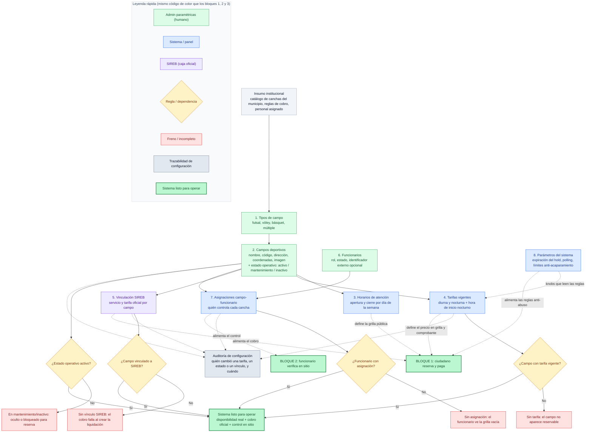

Mismo registro y **misma paleta que los bloques 1, 2 y 3** (verde = actor humano, azul = sistema, morado = SIREB, ámbar = decisión/regla, rojo = freno, gris = trazabilidad, verde fuerte = resultado). Así las cuatro láminas se leen con un solo código de color.

El Bloque 4 es distinto de los otros tres en una cosa importante, y conviene que el jefe la capte: **no es un flujo en tiempo real, es la fábrica de reglas**. Los bloques 1–3 *ejecutan* lo que el bloque 4 *configura*. Por eso el diagrama no es una línea recta 1→n, sino un **grafo de dependencias** (no se puede cobrar sin tarifa, no se puede controlar en sitio sin asignación, no se puede reservar sin campo activo), con **puentes punteados** que muestran exactamente qué pieza de acá alimenta qué bloque de allá.

Copiá esto en un `.md` o en [mermaid.live](https://mermaid.live) para exportarlo a PNG/SVG.



---

## Cómo explicarlo al jefe (guía modular — usá los trozos según cuánto pregunte)

> **Idea madre (decila primero, es la que ordena todo):**
> “Este bloque no es un menú de configuración. Es la **fábrica de reglas**: los tres bloques que vimos antes no inventan nada, **ejecutan lo que se monta acá**. Si esta fábrica está incompleta, los otros tres se frenan solos.”

### 1. El orden no es cosmético, es dependencia (pasos 1→2)
> “Primero se definen los **tipos de cancha** y después las **canchas físicas**, con su dirección, mapa y —importante— su **estado operativo**: activa, en mantenimiento o inactiva. Eso último es lo que decide si una cancha aparece o no para reservar. Si mañana se rompe una, se pone en mantenimiento y **desaparece de la grilla pública sin tocar código**.”

### 2. Horarios y tarifas: la grilla que ve el ciudadano (pasos 3→4)
> “Los **horarios de atención** por día definen qué franjas existen. Las **tarifas diurna y nocturna**, junto con la hora de corte nocturno, definen el precio. De acá sale exactamente la grilla verde/ámbar/roja/gris del Bloque 1, y el monto del comprobante.”

### 3. El puente al cobro: vincular SIREB (paso 5, morado)
> “Acá está el eslabón con la plata. Cada campo se **vincula al servicio y la tarifa oficial de SIREB**. Sin este vínculo, el cobro del Bloque 1 **falla al crear la liquidación** (rojo). Es decir: la cancha puede estar perfecta, pero si no está casada con la caja oficial, no se cobra. Eso es control de transparencia, no burocracia.”

### 4. El puente al control: funcionarios y asignaciones (pasos 6→7)
> “Los **funcionarios** se cargan con su rol, y las **asignaciones** dicen **quién cuida qué cancha**. De acá sale la restricción del Bloque 2: el funcionario de control **solo ve sus campos asignados**. Sin asignación, ve la grilla vacía (rojo). No es un filtro de pantalla: es una regla de seguridad que aplica el sistema.”

### 5. Los perillas del tablero: parámetros del sistema (paso 8)
> “Y los **parámetros** ajustan el comportamiento sin redeploy: cuánto dura el hold antes de expirar, cada cuánto se reconcilia con SIREB, y los **límites anti-acaparamiento** (máximo de franjas por solicitud, máximo de pendientes por IP, bloqueo por expiraciones repetidas). Esas son las reglas ámbar y rojas que el jefe vio frenar abusos en el Bloque 1. Se cambian acá, en un panel, no en una release.”

### 6. La trazabilidad de configuración (nodo gris, líneas punteadas)
> “Y fijate el nodo gris: **cambio de tarifa, de estado o de vínculo SIREB queda auditado** —quién, cuándo, qué—. Porque la configuración también es un activo sensible: si alguien sube una tarifa o desvincula un campo, eso tiene dueño y fecha, igual que una asistencia o un cobro.”

### 7. El resultado (verde fuerte de abajo)
> “Cuando las cuatro validaciones dan verde —tarifa, vínculo SIREB, asignación y estado activo—, el sistema **está listo para operar**: disponibilidad real, cobro oficial y control en sitio, sostenidos por esta fábrica.”

---

## Frase de cierre para el jefe

> “Este bloque es el que responde la pregunta ‘¿y quién puso las reglas?’. La configuración es **trazable, dependiente y con frenos automáticos**: una cancha sin tarifa no se reserva, sin vínculo SIREB no se cobra, sin asignación no se controla. **Las reglas no las decide el operador en el momento: las decide la paramétrica, auditada, antes de que el ciudadano toque nada.**”

---

## Cadena completa de las cuatro láminas

```text
BLOQUE 4  ⚙️ Admin paramétricas monta las reglas   →  fábrica de disponibilidad, cobro y control
                    ↓  (alimenta a los tres siguientes)
BLOQUE 1  🧍 Ciudadano reserva y paga              →  nace RES- / RSV-
BLOQUE 2  🪪 Funcionario controla en sitio         →  verifica identidad y marca asistencia
BLOQUE 3  📋 Administración supervisa              →  concilia la plata y mide el conjunto
                    ↓
        un solo sustrato de trazabilidad inmutable (configuración + operación)
                    ↓
        reglas → reserva → cobro oficial → control → supervisión, auditado
```

O en una frase para cerrar la reunión con las cuatro proyectadas:

> “Primero se **montan las reglas** (B4). Con esas reglas, el ciudadano **pide y paga** por la caja oficial (B1), el funcionario **valida en la puerta** quién entra (B2), y la administración **comprueba la plata y mide el uso** (B3). Todo sobre **una sola trazabilidad auditada**, de la configuración a la operación.”

---

## Nota de uso (porque el bloque es “opcional”)

Este diagrama está diseñado para **saltárselo o usarlo por trozos** según la reacción del jefe:
- Si **no pregunta** cómo se configura el sistema → mostrás solo la **idea madre + el resultado** (nodo gris de arriba y verde de abajo) y pasás al Bloque 5 o al cierre. 20 segundos.
- Si **pregunta “¿y esto quién lo carga?”** → usás los puntos 1, 3 y 4 (dependencias + los dos puentes a SIREB y a control). 1 minuto.
- Si **es técnico y pregunta “¿y los límites anti-abuso dónde se ponen?”** → usás el punto 5 (parámetros) y lo conectás con las reglas ámbar/rojas del Bloque 1. 1 minuto extra.

---

Con esto ya tenés las **cuatro láminas gemelas** (B4 fábrica de reglas → B1 reserva/pago → B2 control → B3 supervisión), mismo código de color, mismo nivel técnico-medio, y los puentes explícitos entre ellas. El siguiente paso natural, si querés cerrar la serie:

1. **Bloque 5 (mobile)** con el mismo estilo, para mostrar que es **multicanal del mismo backend** (no un sistema aparte) — cierra la demo con “y esto también funciona desde el celular”.
2. **Lámina 0 de visión general** (el mapa `⚙️→🧍→🏦→✅→🪪→📊` en grande) para **abrir** la presentación antes de entrar bloque por bloque.
3. **Renderizar los cinco a PNG/SVG en alta resolución** y armarte un **PDF de capacitación** (una lámina + su guía verbal por página), listo para imprimir o mandar por correo.

Decime cuál y lo armo con el mismo criterio. Mi recomendación: **(1) ahora** para cerrar la serie completa, y **(3) al final** cuando ya tengas los cinco, los renderizo todos de una vez en el mismo estilo.
