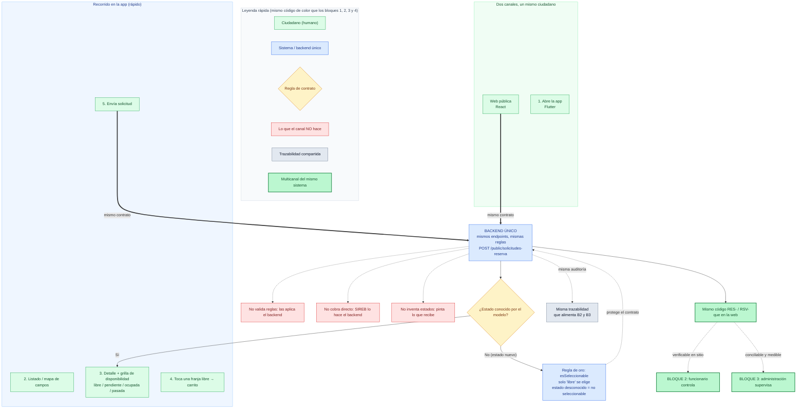

Mismo registro y **misma paleta que los bloques 1–4** (verde = ciudadano, azul = sistema, morado = SIREB, ámbar = decisión, rojo = lo que el canal **no** hace, gris = trazabilidad, verde fuerte = resultado). 

El Bloque 5 es el más fácil de explicar mal, porque la tentación es dibujar de nuevo los 14 pasos del Bloque 1. **No hay que hacerlo.** El mensaje de esta lámina es uno solo: *el mobile no es un flujo nuevo, es la misma cara del Bloque 1 vista desde otro canal*. Por eso el diagrama pone al **backend único en el centro** y muestra los dos canales (web y app) **convergiendo** hacia él, con la regla de robustez que le dimos al modelo (`esSeleccionable`) como garantía de que el contrato no se rompe.

Copiá esto en un `.md` o en [mermaid.live](https://mermaid.live) para exportarlo a PNG/SVG.



---

## Cómo explicarlo al jefe (≈1 minuto, 5 golpes)

> **Idea madre (decila primero y ya tenés el 80%):**
> “Esta lámina no muestra un sistema nuevo. Muestra que **el mismo sistema tiene dos puertas**. El ciudadano entra por la web o por la app y llega al **mismo backend, las mismas reglas y los mismos códigos**. No hay lógica duplicada: hay una sola fuente de verdad.”

### 1. Los dos canales convergen (flechas gruesas al centro)
> “Fijate las dos flechas gruesas: web y app apuntan al **mismo nodo azul**. Eso es el punto. El mobile no decide nada solo: **consulta y obedece** al mismo motor que ya vimos en el Bloque 1.”

### 2. El recorrido en la app es el mismo, más corto (pasos 1→5)
> “En el celular hace lo mismo que en la web: ve las canchas, abre la grilla con los cuatro estados —libre, pendiente, ocupada y **pasada en gris**—, toca una franja y arma el carrito. No te hago el pago acá porque **es idéntico al Bloque 1**: mismo `RES-`, mismo QR, mismo `RSV-` al confirmar.”

### 3. La regla de oro (rombo ámbar + nodo azul) — *este es el argumento de calidad*
> “Acá hay una garantía que le dimos al modelo: **solo lo ‘libre’ se puede elegir**. Si mañana el backend agrega un estado nuevo que el celular todavía no conoce, la app **no se rompe y no deja tocarlo**: lo trata como no-seleccionable por defecto. Traducción: **podemos evolucionar las reglas sin re-estrenar la app cada vez**. Eso es robustez de contrato, no un detalle menor.”

### 4. Lo que el mobile NO hace (los tres rojos) — *esto tranquiliza a un jefe técnico*
> “Y los rojos son igual de importantes: el celular **no valida reglas, no cobra directo con SIREB y no inventa estados**. Todo eso vive en el backend. ¿Por qué importa? Porque si la regla estuviera en dos lugares, la web y la app podrían **divergir** y cobrar distinto o reservar mal. Al vivar en un solo sitio, **es imposible que se contradigan**.”

### 5. El puente a la cadena (líneas punteadas a B2/B3)
> “Y el `RES-`/`RSV-` que sale de la app es **exactamente el mismo** que el funcionario verifica en la puerta (B2) y que la administración concilia y mide (B3). Mismo código, misma auditoría, mismo sustrato.”

---

## Frase de cierre para el jefe

> “El mobile no es un proyecto paralelo ni una segunda versión: es **otro canal del mismo cerebro**. Una sola regla, un solo cobro oficial, una sola trazabilidad, dos puertas. Y con una garantía de contrato que nos deja crecer sin romper lo que ya funciona.”

---

## Cadena completa de las cinco láminas

```text
BLOQUE 4  ⚙️ Paramétricas monta las reglas        →  fábrica de disponibilidad, cobro y control
BLOQUE 1  🧍 Ciudadano reserva y paga (web)       →  nace RES- / RSV-
BLOQUE 5  📱 Ciudadano reserva y paga (app)       →  MISMO RES- / RSV-, otro canal
BLOQUE 2  🪪 Funcionario controla en sitio        →  verifica identidad y marca asistencia
BLOQUE 3  📋 Administración supervisa             →  concilia la plata y mide el conjunto
                    ↓
        un solo sustrato de trazabilidad inmutable (configuración + operación)
                    ↓
   reglas → reserva (web/app) → cobro oficial → control → supervisión, auditado
```

O en una frase para cerrar la reunión con las cinco proyectadas:

> “Se **montan las reglas** (B4). Con esas reglas el ciudadano **pide y paga** por la caja oficial, **desde la web o desde el celular**, que son la misma puerta (B1 + B5). El funcionario **valida en la entrada** quién entra (B2). Y la administración **comprueba la plata y mide el uso** (B3). **Una sola verdad, auditada de punta a punta, con dos canales.**”

---

## Nota de uso (porque es “cierre rápido”)

- Si el jefe **ya entendió que es multicanal** con la idea madre → mostrás solo los **dos canales convergiendo al nodo azul** y la **frase de cierre**. 20 segundos.
- Si es **técnico y pregunta “¿y si cambian las reglas?”** → usás el punto **3 (regla de oro)** y el **4 (lo que no hace)**. Ese es el argumento que más valor tiene para él: mantenimiento y no-divergencia.
- Si **no hay app instalada/emulador** → esta lámina se sostiene **solo con el diagrama**, porque el mensaje es arquitectónico (“mismo backend”), no de demo en vivo. A diferencia de B1/B2, acá no necesitás tener la pantalla corriendo.

---

Con esto la **serie está completa**: B4 fábrica → B1 web → B5 app → B2 control → B3 supervisión, las cinco con el mismo código de color, el mismo nivel técnico-medio y los puentes explícitos entre ellas. Ahora sí, el siguiente paso natural es **cerrar el paquete**:

1. **Renderizar las 5 láminas a PNG/SVG en alta resolución** y armarte un **PDF de capacitación** (una lámina + su guía verbal por página), listo para imprimir o mandar por correo. *Esta es mi recomendación: la serie ya está cerrada, es el momento de solidificarla.*
2. **Lámina 0 de visión general** (el mapa `⚙️→🧍📱→🏦→✅→🪪→` en grande) para **abrir** la presentación antes de bloque por bloque.
3. **Versión ejecutiva de 1 slide** que condense las 5 en una sola imagen para autoridades que no ven la demo completa.

Decime cuál y lo armo con el mismo criterio. Si querés el PDF (opción 1), decime también si lo preferís **por bloque** (5 páginas, cada una con su diagrama + guía) o **temático** (una página de “ciudadano”, una de “control”, una de “supervisión”, una de “montaje”), que cambia cómo se folia y cómo se lee en impresión.
